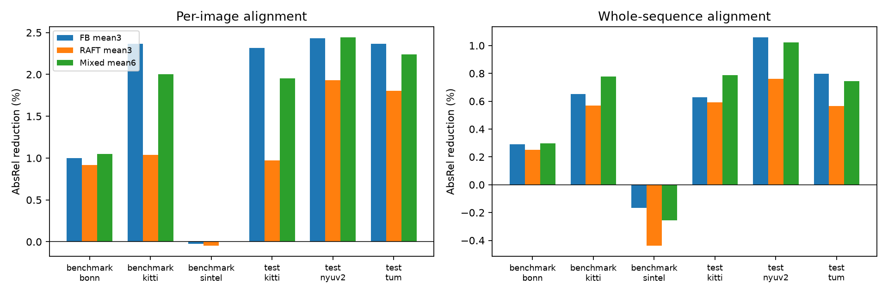
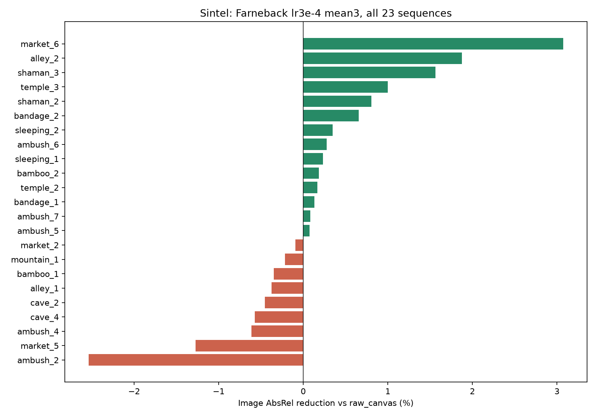
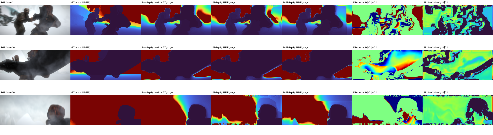
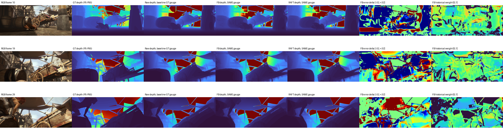
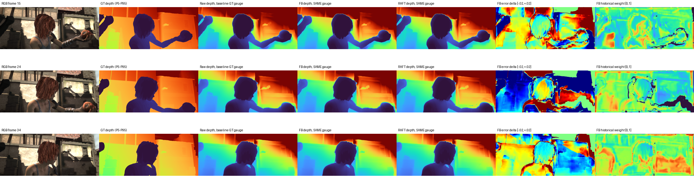
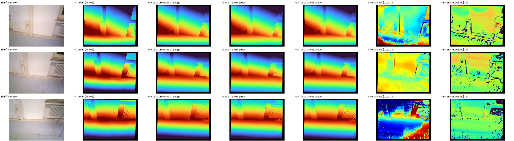
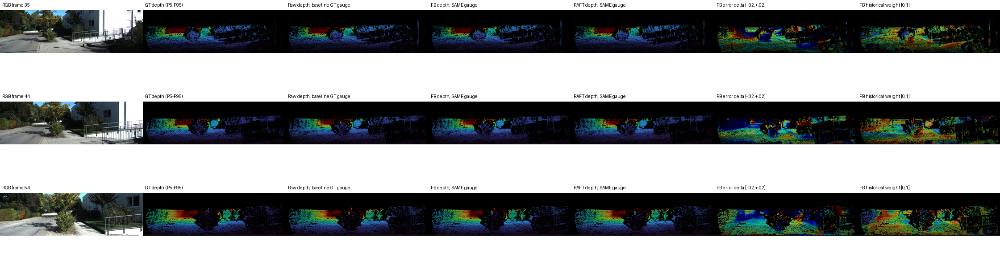

# 当前训练结果分析与 Sintel 诊断

日期：2026-11-11。对象：当前 `shared_models_evaluation_v2` 中全部 99 行汇总结果，包含 11 个注册单模型/冻结参考、4 个 ensemble 和自动 raw baseline；其中 benchmark 17 行/数据集，test 16 行/数据集。

## 结论

1. lr3e-4 在真实数据集上的小幅改善具有跨种子、跨片段的一致性；Sintel 的收益受场景影响明显，有益片段与退化片段相互抵消。不能把整体接近零理解为所有片段都学不到。
2. Sintel 的主要限制是：融合头只在两帧 DA2 预测之间选择，难以修复两帧共有的结构性深度误差；困难运动片段还存在历史可用区域减少和较高融合风险。真实数据训练与 Sintel 的域差异、训练目标与正式评分的差异共同影响收益。
3. 抽样门控没有接近零：可用区域上的历史权重约 0.39–0.55，排除了“完全没用历史”这个简单解释。部分片段仍有明显 oracle 余量，不能认定当前模型已达到可实现上限，更不能直接据此证明欠拟合。
4. RAFT 未形成稳定优势；增加 seed 的等权 ensemble 收益很小。当前结果更支持 Farnebäck lr3e-4 作为成本较低的候选。最终选择应在 dev 上完成，test/benchmark 用于报告。

## 1. 数据、口径与覆盖

- 本报告读取正式结果，不覆盖它们。比较表、session 和 registry 的快照均保存在本报告旁的审计目录中。
- 六组范围：benchmark/Bonn、KITTI、Sintel；held-out test/KITTI、NYUv2、TUM。没有本次 TUM validation 的结果，也没有 lr5e-4、旧 RAFT lr1e-4、final_flow 的本次结果；不能据此评价这些实验。
- Sintel：training/final，23 段、1064 帧。逐图按 AC：GT 截断 72 m，inverse-depth 无约束 LS，预测深度截断 80 m，depth AbsRel/δ1，按帧平均。视频指标保留 GT<70 m、整段统一拟合、序列宏平均。两列的 mask、范围、对齐与聚合不同，不能把其差直接解释为闪烁强弱。
- 其他数据集按原有协议。raw_canvas 是与融合头相同输入预测、经过融合画布的基线；raw_native 是相同前端的原图输出。DA2 FP32 同时改变精度、输入尺寸规则和插值设置，不能把其差距全归于 FP16。
- 本次新增模型、ensemble 与 raw_canvas 的 case 和评分帧数一致。Bonn 26 段共 12541 输入帧，其中 12521 帧有有效逐图评分；Sintel 1064 帧全部参与 AC。
- KITTI benchmark 是 held-out test 的重叠子集；二者不是独立的两次泛化验证。训练只包含 KITTI、TUM、NYUv2，Sintel 与 Bonn 不参与融合头训练。RAFT 冻结权重本身包含 Sintel 等光流训练数据，不能把整条 RAFT 流程称为完全未接触 Sintel。
- 全部主表指标经过 GT 对齐，是相对几何准确性。UniDepthV2 的这些优势不等同于未对齐的米制误差优势。

## 2. 所有实验的总体趋势

下表均相对 raw_canvas，正数为 AbsRel 下降。每格为“逐图 / 整段”的相对改善百分比。

| 范围 | FB lr1e-4 ×3 | FB lr3e-4 ×3 | RAFT lr3e-4 ×3 | 混合 lr3e-4 ×6 |
| --- | --- | --- | --- | --- |
| benchmark/bonn | +0.857% / +0.253% | +1.001% / +0.292% | +0.919% / +0.250% | +1.048% / +0.296% |
| benchmark/kitti | +1.910% / +0.524% | +2.367% / +0.650% | +1.039% / +0.569% | +2.003% / +0.777% |
| benchmark/sintel | +0.130% / -0.051% | -0.026% / -0.167% | -0.049% / -0.439% | +0.004% / -0.256% |
| test/kitti | +1.873% / +0.500% | +2.316% / +0.629% | +0.974% / +0.593% | +1.953% / +0.787% |
| test/nyuv2 | +2.230% / +0.973% | +2.432% / +1.060% | +1.929% / +0.762% | +2.444% / +1.022% |
| test/tum | +2.017% / +0.699% | +2.367% / +0.797% | +1.803% / +0.565% | +2.242% / +0.745% |

### 学习率与随机种子

Farnebäck lr3e-4 的三种子组合相比 lr1e-4 三种子组合，在五个真实数据范围的逐图 AbsRel 额外改善约 0.15%–0.47%。同一数据集上，三个 lr3e-4 种子通常非常接近；KITTI test 三个单模型为 0.087513、0.087504、0.087518，均优于三个 lr1e-4 单模型。这是优化改善的证据，不能单独区分欠拟合、训练长度不足或损失/架构瓶颈。Sintel 上 lr3e-4 并未延续该趋势。

### 光流与 ensemble

RAFT lr3e-4 三种子组合在六组范围的逐图 AbsRel 均弱于 Farnebäck 三种子组合。其历史可用区域有时更大，但“更多像素通过几何检查”不等于历史深度更准确。六模型组合在 KITTI 的整段 AbsRel 上更好，却牺牲了相对 FB×3 的逐图误差；Bonn、NYUv2 的部分指标仅有极小收益，TUM 没有优势。种子平均主要降低训练随机性，不会创造新的深度信息。

### 冻结参考

UniDepthV2 在五组真实数据的四项主指标上均明显领先当前融合头。Sintel 上则存在指标权衡：其整段 AbsRel 最低，但 δ1 低于 DA2，不能说全部指标最好。DA2 FP32 在 Sintel 的逐图 AbsRel 为 0.239514，优于 raw_canvas 的 0.241631，也优于所有融合结果；这说明前端配置造成的差异已经大于当前融合收益。KITTI test 上 DA2 FP32 的逐图误差和 δ1 也好于融合头，而融合头的整段 AbsRel 较低。NYUv2、TUM 和 Bonn 上当前 FB 融合可小幅优于 DA2 FP32，但仍明显落后于 UniDepthV2。

### 片段一致性

以下以 FB lr3e-4×3 相对 raw_canvas 的逐图 AbsRel 为准。bootstrap 以完整 case 为抽样单元；Sintel 保留帧数权重。它仅描述本批片段重采样的波动，不代表新的数据集或训练随机性；KITTI test 的相机分支也不是完全独立样本。

| 范围 | 改善 / case 数 | 退化 | 增益的 case bootstrap 95% 区间 |
| --- | --- | --- | --- |
| benchmark/bonn | 26/26 | 0 | +0.87% 至 +1.13% |
| benchmark/kitti | 12/13 | 1 | +1.81% 至 +2.85% |
| benchmark/sintel | 14/23 | 9 | -0.52% 至 +0.58% |
| test/kitti | 23/26 | 3 | +1.92% 至 +2.67% |
| test/nyuv2 | 9/9 | 0 | +1.73% 至 +3.09% |
| test/tum | 20/20 | 0 | +2.03% 至 +2.74% |

## 3. Sintel 的“接近零提升”由什么构成

FB lr3e-4×3 在 23 段中有 14 段改善、9 段退化。最大改善 market_6 为 +3.08%，最大退化 ambush_2 为 −2.54%；总逐图 AbsRel 却从 0.241631 变为 0.241693（−0.026%）。Sintel 的高基础误差也说明它不是已经“太容易、没有提升空间”。

| 片段 | 帧数 | raw AbsRel Img | FB×3 AbsRel Img | 相对改善 | 对总 AbsRel 的变化贡献 |
| --- | --- | --- | --- | --- | --- |
| ambush_2 | 21 | 0.679752 | 0.697011 | -2.539% | +0.0003406 |
| market_5 | 50 | 0.418150 | 0.423473 | -1.273% | +0.0002501 |
| ambush_4 | 33 | 0.281143 | 0.282862 | -0.612% | +0.0000533 |
| cave_4 | 50 | 0.298279 | 0.299984 | -0.572% | +0.0000801 |
| cave_2 | 50 | 0.418012 | 0.419903 | -0.452% | +0.0000889 |
| alley_1 | 50 | 0.649820 | 0.652259 | -0.375% | +0.0001146 |
| bamboo_1 | 50 | 0.251792 | 0.252675 | -0.351% | +0.0000415 |
| mountain_1 | 50 | 0.025357 | 0.025412 | -0.219% | +0.0000026 |
| market_2 | 50 | 0.186283 | 0.186458 | -0.094% | +0.0000082 |
| ambush_5 | 50 | 0.365142 | 0.364869 | +0.075% | -0.0000128 |
| ambush_7 | 50 | 0.059301 | 0.059252 | +0.083% | -0.0000023 |
| bandage_1 | 50 | 0.102818 | 0.102684 | +0.130% | -0.0000063 |
| temple_2 | 50 | 0.332626 | 0.332067 | +0.168% | -0.0000263 |
| bamboo_2 | 50 | 0.353642 | 0.352983 | +0.186% | -0.0000310 |
| sleeping_1 | 50 | 0.067202 | 0.067045 | +0.232% | -0.0000073 |
| ambush_6 | 20 | 0.174988 | 0.174506 | +0.275% | -0.0000090 |
| sleeping_2 | 50 | 0.074005 | 0.073749 | +0.346% | -0.0000120 |
| bandage_2 | 50 | 0.135949 | 0.135056 | +0.656% | -0.0000419 |
| shaman_2 | 50 | 0.077262 | 0.076641 | +0.804% | -0.0000292 |
| temple_3 | 50 | 0.274399 | 0.271659 | +0.999% | -0.0001288 |
| shaman_3 | 50 | 0.054745 | 0.053889 | +1.564% | -0.0000402 |
| alley_2 | 50 | 0.157191 | 0.154240 | +1.878% | -0.0001387 |
| market_6 | 40 | 0.373604 | 0.362116 | +3.075% | -0.0004318 |

### 对齐方式会改变结论，不能据此删掉不利指标

正式整段评分为每个预测分支独立拟合 inverse-depth LS，其优化目标不是 depth AbsRel。重新拟合可能降低 inverse 的平方误差，却增大 depth AbsRel；因此固定 baseline 对齐后的正收益，与重新拟合后的退化可以同时出现。

| Sintel 模型 | 逐图 AbsRel（AC） | 整段 AbsRel（独立拟合） | 整段 AbsRel（baseline 固定拟合） |
| --- | --- | --- | --- |
| raw_canvas | 0.241631 | 0.416061 | 0.416061 |
| farneback_lr3e-4_mean3 | 0.241693 | 0.416756 | 0.413323 |
| raft_lr3e-4_mean3 | 0.241749 | 0.417888 | 0.414386 |
| farneback_raft_lr3e-4_mean6 | 0.241622 | 0.417126 | 0.413095 |

FB×3 的 baseline-fixed video AbsRel 降幅约 0.66%，但正式 video AbsRel 退化约 0.17%。这表明融合确实改变了预测，不能据此宣称没有学习；正式 AC 逐图和独立拟合视频仍无提升，也不能把问题全部解释为指标“掩盖”了成功。ordinal_accuracy 从 0.916227 到 0.915858（FB×3），RAFT×3 为 0.917320：排序也没有呈现全面一致的收益。这里的 ordinal 是传感器/渲染 GT 派生的随机深度对，不是 DA-2K 官方标注。

## 4. 视频抽样、可视化与 oracle

本次新增 100 帧诊断：三个 Sintel 片段（最差 ambush_2、最好 market_6、基础误差高但历史可用性高的 alley_1），以及一个 Bonn、一个 KITTI 片段。选择旨在解释机制，刻意包含不同表现，不把这五段当成无偏总体抽样。每段取中间连续 20 帧，ambush_2 因长度仅 21 帧而取索引 1–20。前一帧保持真实相邻帧，不人为重置历史。

仅对两个 lr3e-4 seed2026 单模型做详细前向，不能将其诊断数值直接当作六模型均值的行为。本机 online 推理、禁用 DGX 与缓存，仅改变传输/执行路径，不修改模型、输入和推理数值规则。诊断保存于 `reports/sintel_20261111/`，每帧结果见 `sample_diagnostics.json`，汇总见 `sample_summary.json`，脚本为 `diagnose.py`。

下表使用同一帧 raw_canvas 对 GT 的固定正 scale/shift，将 raw、fused 和 oracle 一起转换到深度后评分。Sintel GT 按 AC 截断 72 m，但该诊断不是正式 AC：不重新拟合每个分支，使用 FP64 拟合；其他数据遵循原有效 GT mask。因此该表只能作机制比较，正式排名仍见主表。

oracle 定义：在几何允许使用历史的位置，GT 告知当前值与对齐后历史值之间的最佳连续混合比例；不可用位置保留当前值。GT 不进入正常推理。它是该固定 gauge、该两帧凸混合族的乐观上界，并不是正式 AC 分数的上界。历史有效性由还原到原图后的 availability>0.999 定义，避免边界插值污染。

| 片段 | 零基帧索引 | 模型 | 历史可用率 | 可用区历史权重 | 两帧逆深度误差相关 | Raw | Fused | Oracle | Oracle 余量 |
| --- | --- | --- | --- | --- | --- | --- | --- | --- | --- |
| ambush_2 | 1–20 | FB | 56.9% | 0.395 | 0.837 | 0.63605 | 0.62067 | 0.52040 | 18.2% |
| ambush_2 | 1–20 | RAFT | 56.4% | 0.470 | 0.744 | 0.63605 | 0.62599 | 0.53972 | 15.1% |
| market_6 | 10–29 | FB | 72.6% | 0.400 | 0.824 | 0.34825 | 0.33445 | 0.29018 | 16.7% |
| market_6 | 10–29 | RAFT | 80.8% | 0.542 | 0.909 | 0.34825 | 0.34525 | 0.30463 | 12.5% |
| alley_1 | 15–34 | FB | 95.3% | 0.456 | 0.975 | 0.67420 | 0.66901 | 0.63321 | 6.1% |
| alley_1 | 15–34 | RAFT | 96.0% | 0.548 | 0.978 | 0.67420 | 0.66543 | 0.63302 | 6.1% |
| rgbd_bonn_static | 240–259 | FB | 86.8% | 0.500 | 0.854 | 0.02262 | 0.02269 | 0.01821 | 19.5% |
| rgbd_bonn_static | 240–259 | RAFT | 100.0% | 0.468 | 0.860 | 0.02262 | 0.02157 | 0.01633 | 27.8% |
| 2011_09_26_drive_0079_sync | 35–54 | FB | 93.9% | 0.485 | 0.954 | 0.09199 | 0.08750 | 0.07792 | 15.3% |
| 2011_09_26_drive_0079_sync | 35–54 | RAFT | 99.7% | 0.458 | 0.937 | 0.09199 | 0.08860 | 0.07819 | 15.0% |

可用区权重不是全图权重，也不是历史信息正确率。误差相关只在可用且有 GT 的像素上计算，不能替代光流 EPE；KITTI 同样高度相关，因此“相关高”本身不能独立解释 Sintel。

### ambush_2：困难运动、模糊、遮挡与远背景

连续图像里有近距离人物/武器运动、明显运动模糊与大面积浅色远背景。FB、RAFT 可用率都约 56%–57%，远低于抽样 KITTI；其中约 38.4% 的正 GT 像素 >=72 m，会进入 AC 的远深度截断区。人物与背景边界的误差改变呈正负混杂，融合不能简单统一纠正。FB 的同 gauge 误差从 0.6360 降为 0.6207，oracle 为 0.5204：存在可利用信息，但学到的门控只利用了一部分。完整片段、三种子 ensemble 的正式 AC 反而退化，进一步说明单段样本、单模型、对齐协议之间需要分别报告。

[ambush_2 连续 RGB 动图](sintel_20261111/ambush_2.gif)

### market_6：有互补信息时，Sintel 也能改善

场景包含车轮、木梁、人物和细结构遮挡，连续画面视角有明显变化。可用率 FB 72.6%、RAFT 80.8%；同 gauge 下 FB 从 0.3482 降为 0.3344，优于 RAFT 的 0.3452。完整片段 FB×3 的正式 AC 改善 3.08%，说明合成域并非一律无法使用历史。RAFT 更高可用率却没有更好误差，排除了“只要换更强光流便能解决”的简单解释。

[market_6 连续 RGB 动图](sintel_20261111/market_6.gif)

### alley_1：历史可用，但两帧共享深度结构错误

可用率约 95%–96%，历史权重约 0.46–0.55；两帧误差相关约 0.975–0.978，FB 实际修改幅度仅为当前预测 P90−P10 尺度的约 0.62%。图中人物和背景表面的大尺度深度关系在 raw、FB、RAFT 间几乎相同，历史平均不能产生缺失的正确表面结构。FB 的 raw 0.6742、fused 0.6690、oracle 0.6332：即使知道逐像素最佳混合，仍残留较大误差；其 oracle 相对余量仅约 6.1%。这段说明光流可用性不足不是唯一原因。

[alley_1 连续 RGB 动图](sintel_20261111/alley_1.gif)

### 与真实视频对照

Bonn static 的白墙、门与地面几何较简单，KITTI 片段主要为庭院道路和建筑。Bonn 的 FB 可用率 86.8%，RAFT 近 100%；KITTI 为 93.9% / 99.7%。但 Bonn 这 20 帧中 FB 的同 gauge 误差微升，RAFT 改善；完整 500 帧的正式 FB×3 仍改善 1.77%。片段内门控收益并不均匀，不能用单个可视化样本代替完整视频的结论。KITTI 抽样 FB 同 gauge 从 0.0920 降至 0.0875，oracle 0.0779，显示模型利用了部分历史信息。

[Bonn 连续 RGB 动图](sintel_20261111/rgbd_bonn_static.gif)

[KITTI 连续 RGB 动图](sintel_20261111/2011_09_26_drive_0079_sync.gif)

图例：每张图抽三个时刻，列依次为 RGB、GT、raw、FB、RAFT、FB−raw 的逐像素 AbsRel 差、FB 历史权重。深度图在同一行共享 GT P5–P95 色阶，深紫近、红远，黑色为无有效 GT；误差差图 blue=改善、green≈0、red=退化，范围 ±0.02；权重 blue=0、red=1。KITTI 图只显示有激光 GT 的稀疏区域，不能把黑色视为模型没输出。

## 5. 机制判断与证据强弱

### 已由代码或结果确认

- **模型能力受凸混合限制。** 当前 `GuidedUNet` 仅输出 blend/reset 两个门控；最终值为当前预测与光流 warp、仿射对齐历史预测的凸组合，没有额外深度修正项，没有独立时序深度 backbone。两者同向犯错时，即使门控完美，也不能超出该区间恢复正确结构。
- **两帧而非长时序。** 历史输入是前一帧原始 DA2 深度，不递归使用融合结果；每帧只有前一帧信息。换 seed、增加 ensemble 不会增加时间跨度。
- **门控没有关闭。** 五段可用区平均权重均远大于零。难点是挑选历史是否正确，以及历史本身是否包含新信息。
- **训练分布和评分分布不同。** 训练数据为真实 KITTI/TUM/NYUv2；Bonn 是较接近真实 RGB-D 的迁移，Sintel 是电影式渲染与复杂非刚性动态。不能把 DA2 自身说成没见过合成数据：DA2 教师使用合成标注，学生经大规模真实伪标签学习，域偏差主要针对当前融合头与具体渲染/运动模式。
- **训练损失并不等于 AC AbsRel。** 相对深度主损失在 baseline 固定 GT gauge 下归一化 inverse-depth，外加 blend/reset BCE；正式 Sintel 评分重新拟合后在 depth 空间测量。这种差异与固定 gauge 改善、正式指标不改善的结果一致，但尚未通过损失消融证明因果。
- **当前 GuidedUNet 没有额外 temporal loss。** `two_frame.supervised()` 对非 FinalFlow 在计算普通 fusion_loss 后直接返回。即使配置有 temporal_weight，不能据此说当前这些 guided 模型优化了专门的双向时序损失；训练日志的 temporal_loss=0 与此一致。这也使“video 指标稍好”不能替代直接闪烁评估。
- **画布降低 Sintel 细节分辨率。** 原图 436×1024 进入 384×512 融合画布时有效图像为 218×512，上下 padding 共 166 行，占画布高度约 43.2%。细结构与运动边界容易损失；但 raw_canvas 与 raw_native 的逐图差仅约 0.000341，且 KITTI 也经缩放，所以画布不是目前全部问题的充分解释。

### 当前最合理的综合解释

Sintel 的误差包含两类：两帧均犯的语义/结构错误，以及运动、遮挡、模糊导致的历史传递错误。当前架构只能降低两帧间可互补的那部分误差；在简单真实几何上收益较一致，在 Sintel 上好坏像素和好坏片段更容易抵消。训练域与损失差异进一步让门控在困难片段选择不足。抽样 oracle 证明“仍有门控学习空间”和“部分结构误差超出凸混合能力”同时存在，单纯延长训练或换更大光流未必解决两者。

Sintel 官方明确包含大运动、镜面反射、运动/散焦模糊和大气效果；final pass 包含完整渲染效果，与本次 ambush_2 的视觉现象一致。[MPI Sintel 官方介绍](https://sintel.is.tue.mpg.de/)，[原始论文](https://files.is.tue.mpg.de/black/papers/ButlerECCV2012-corrected.pdf)。DA2 训练数据与教师/学生机制参见[原论文](https://arxiv.org/abs/2406.09414)。AC 口径依据[Depth Anything at Any Condition](https://arxiv.org/abs/2507.01634)及[官方代码](https://github.com/HVision-NKU/DepthAnythingAC)。本报告不把这些外部资料当作当前模型具体退化的因果实验证据。

## 6. 对后续工作的建议

1. 保留当前正式口径；同时在报告中展示 baseline-fixed 诊断，避免在重新拟合之后看不到预测实际变化，也避免只选有利指标。
2. 当前低成本候选优先考察 FB lr3e-4 单模型/三种子平均；六模型 ensemble 没有足够一致的收益支撑其推理开销。用 dev 确定模型，不按本次 test 反复挑 seed。
3. 若下一步要专门解释“优化不足还是输入不足”，对完整 Sintel 23 段做相同 mask、同 gauge 的两帧 oracle，按动态/遮挡/边界区域分解。抽样已证明存在余量，但不能把抽样 oracle 当作完整测试集上限。
4. 若目标是提升 Sintel 泛化，优先在独立训练数据中加入相应动态与渲染条件，或研究训练损失与目标评价的一致性；不要将当前 Sintel benchmark 直接加入训练后继续宣称独立泛化。
5. 若 oracle 本身改善有限，应考虑超出凸混合的修正头或更丰富时序信息；这是架构/协议选择，需要与当前两帧约束一起明确。不能仅以 RAFT 更强为由继续增加光流计算。
6. 若目标是视频稳定性，需要增加遮挡/运动补偿的时序误差或一致性可视化；目前整段 SSI 指标没有直接测量闪烁。本报告没有训练新模型、修改正式评分或启动完整评估。

## 附录：当前全部比较结果

以下为审计时正式 `comparison.md` 的完整快照。保留所有行和原始精度，便于与上述分析核对。

### 完整主表

Public baselines are evaluated once.

Sintel: final, all 1064 frames. Image metrics use AC (GT cap 72 m, prediction cap 80 m, per-image inverse alignment, depth metrics, frame mean). Video metrics use the 70 m mask and one alignment per sequence, then sequence macro. Other datasets retain their existing protocol.

| scope | dataset | model | image_standard | image_frames | absrel_img | absrel_video | delta1_img | delta1_video |
| --- | --- | --- | --- | --- | --- | --- | --- | --- |
| benchmark | bonn | da2_fp32 | image-video-depth-v1 | — | 0.050845073 | 0.125324168 | 0.978670677 | 0.862157128 |
| benchmark | bonn | farneback_lr3e-4_mean3 | image-video-depth-v1 | — | 0.050188335 | 0.124773961 | 0.979458970 | 0.862549577 |
| benchmark | bonn | farneback_raft_lr3e-4_mean6 | image-video-depth-v1 | — | 0.050164492 | 0.124769467 | 0.979513770 | 0.862579597 |
| benchmark | bonn | farneback_unet_guided_lr1e-4 | image-video-depth-v1 | — | 0.050268484 | 0.124842387 | 0.979333563 | 0.862486299 |
| benchmark | bonn | farneback_unet_guided_lr3e-4 | image-video-depth-v1 | — | 0.050224095 | 0.124798656 | 0.979418979 | 0.862453591 |
| benchmark | bonn | farneback_unet_guided_lr3e-4_seed_1 | image-video-depth-v1 | — | 0.050205934 | 0.124781648 | 0.979426392 | 0.862569915 |
| benchmark | bonn | farneback_unet_guided_lr3e-4_seed_2 | image-video-depth-v1 | — | 0.050158372 | 0.124756822 | 0.979498456 | 0.862614112 |
| benchmark | bonn | farneback_unet_guided_seed_1 | image-video-depth-v1 | — | 0.050268441 | 0.124821742 | 0.979336860 | 0.862521889 |
| benchmark | bonn | farneback_unet_guided_seed_2 | image-video-depth-v1 | — | 0.050262899 | 0.124817506 | 0.979354239 | 0.862523494 |
| benchmark | bonn | raft_lr3e-4_mean3 | image-video-depth-v1 | — | 0.050229646 | 0.124826693 | 0.979486695 | 0.862613416 |
| benchmark | bonn | raft_unet_guided_lr3e-4 | image-video-depth-v1 | — | 0.050221599 | 0.124830298 | 0.979482583 | 0.862640320 |
| benchmark | bonn | raft_unet_guided_lr3e-4_seed_1 | image-video-depth-v1 | — | 0.050252700 | 0.124835919 | 0.979464080 | 0.862583465 |
| benchmark | bonn | raft_unet_guided_lr3e-4_seed_2 | image-video-depth-v1 | — | 0.050233146 | 0.124826708 | 0.979495870 | 0.862612520 |
| benchmark | bonn | raw_canvas | image-video-depth-v1 | — | 0.050695618 | 0.125139582 | 0.978902403 | 0.862268571 |
| benchmark | bonn | raw_native | image-video-depth-v1 | — | 0.050835502 | 0.125297475 | 0.978679734 | 0.862206273 |
| benchmark | bonn | unet_guided_mean | image-video-depth-v1 | — | 0.050261243 | 0.124823495 | 0.979349108 | 0.862512009 |
| benchmark | bonn | unidepthv2 | image-video-depth-v1 | — | 0.034830320 | 0.101886368 | 0.989436542 | 0.915971577 |
| benchmark | kitti | da2_fp32 | image-video-depth-v1 | — | 0.083147612 | 0.130482584 | 0.938728969 | 0.842269546 |
| benchmark | kitti | farneback_lr3e-4_mean3 | image-video-depth-v1 | — | 0.082932008 | 0.127596164 | 0.933412326 | 0.836519986 |
| benchmark | kitti | farneback_raft_lr3e-4_mean6 | image-video-depth-v1 | — | 0.083240600 | 0.127432807 | 0.933426973 | 0.836928925 |
| benchmark | kitti | farneback_unet_guided_lr1e-4 | image-video-depth-v1 | — | 0.083225874 | 0.127699568 | 0.933063552 | 0.836291520 |
| benchmark | kitti | farneback_unet_guided_lr3e-4 | image-video-depth-v1 | — | 0.082963440 | 0.127641950 | 0.933344756 | 0.836404767 |
| benchmark | kitti | farneback_unet_guided_lr3e-4_seed_1 | image-video-depth-v1 | — | 0.082960071 | 0.127606828 | 0.933389366 | 0.836501955 |
| benchmark | kitti | farneback_unet_guided_lr3e-4_seed_2 | image-video-depth-v1 | — | 0.082973052 | 0.127607779 | 0.933398883 | 0.836556527 |
| benchmark | kitti | farneback_unet_guided_seed_1 | image-video-depth-v1 | — | 0.083523637 | 0.127878377 | 0.932640048 | 0.835851487 |
| benchmark | kitti | farneback_unet_guided_seed_2 | image-video-depth-v1 | — | 0.083307169 | 0.127766125 | 0.932917989 | 0.836068054 |
| benchmark | kitti | raft_lr3e-4_mean3 | image-video-depth-v1 | — | 0.084060110 | 0.127700572 | 0.932817109 | 0.836597892 |
| benchmark | kitti | raft_unet_guided_lr3e-4 | image-video-depth-v1 | — | 0.084093250 | 0.127691192 | 0.932847885 | 0.836586824 |
| benchmark | kitti | raft_unet_guided_lr3e-4_seed_1 | image-video-depth-v1 | — | 0.084077595 | 0.127746680 | 0.932716114 | 0.836434700 |
| benchmark | kitti | raft_unet_guided_lr3e-4_seed_2 | image-video-depth-v1 | — | 0.084076751 | 0.127710648 | 0.932758444 | 0.836675975 |
| benchmark | kitti | raw_canvas | image-video-depth-v1 | — | 0.084942395 | 0.128431125 | 0.931051996 | 0.835657498 |
| benchmark | kitti | raw_native | image-video-depth-v1 | — | 0.085067258 | 0.128525334 | 0.931136168 | 0.835735857 |
| benchmark | kitti | unet_guided_mean | image-video-depth-v1 | — | 0.083320238 | 0.127758289 | 0.932914254 | 0.836114180 |
| benchmark | kitti | unidepthv2 | image-video-depth-v1 | — | 0.060328291 | 0.093844602 | 0.959562176 | 0.912806119 |
| benchmark | sintel | da2_fp32 | depthanything-ac-sintel-final-v1 | 1064.000000000 | 0.239513572 | 0.403235183 | 0.712228520 | 0.551038829 |
| benchmark | sintel | farneback_lr3e-4_mean3 | depthanything-ac-sintel-final-v1 | 1064.000000000 | 0.241692992 | 0.416755643 | 0.709452201 | 0.543199607 |
| benchmark | sintel | farneback_raft_lr3e-4_mean6 | depthanything-ac-sintel-final-v1 | 1064.000000000 | 0.241621618 | 0.417125718 | 0.709825860 | 0.543491132 |
| benchmark | sintel | farneback_unet_guided_lr1e-4 | depthanything-ac-sintel-final-v1 | 1064.000000000 | 0.241223656 | 0.416080163 | 0.709678324 | 0.543600229 |
| benchmark | sintel | farneback_unet_guided_lr3e-4 | depthanything-ac-sintel-final-v1 | 1064.000000000 | 0.241510041 | 0.416283771 | 0.709603591 | 0.543095897 |
| benchmark | sintel | farneback_unet_guided_lr3e-4_seed_1 | depthanything-ac-sintel-final-v1 | 1064.000000000 | 0.242100270 | 0.416486957 | 0.708967581 | 0.542941916 |
| benchmark | sintel | farneback_unet_guided_lr3e-4_seed_2 | depthanything-ac-sintel-final-v1 | 1064.000000000 | 0.241496141 | 0.417299114 | 0.709690138 | 0.543455058 |
| benchmark | sintel | farneback_unet_guided_seed_1 | depthanything-ac-sintel-final-v1 | 1064.000000000 | 0.241490866 | 0.416248716 | 0.709334964 | 0.543369406 |
| benchmark | sintel | farneback_unet_guided_seed_2 | depthanything-ac-sintel-final-v1 | 1064.000000000 | 0.241313824 | 0.416540153 | 0.709646720 | 0.543377755 |
| benchmark | sintel | raft_lr3e-4_mean3 | depthanything-ac-sintel-final-v1 | 1064.000000000 | 0.241748856 | 0.417887754 | 0.710047855 | 0.543691362 |
| benchmark | sintel | raft_unet_guided_lr3e-4 | depthanything-ac-sintel-final-v1 | 1064.000000000 | 0.242070758 | 0.417807448 | 0.709773719 | 0.543566334 |
| benchmark | sintel | raft_unet_guided_lr3e-4_seed_1 | depthanything-ac-sintel-final-v1 | 1064.000000000 | 0.241594680 | 0.417925715 | 0.709674348 | 0.543814006 |
| benchmark | sintel | raft_unet_guided_lr3e-4_seed_2 | depthanything-ac-sintel-final-v1 | 1064.000000000 | 0.241547139 | 0.417758516 | 0.710232762 | 0.543560549 |
| benchmark | sintel | raw_canvas | depthanything-ac-sintel-final-v1 | 1064.000000000 | 0.241630757 | 0.416060667 | 0.708687268 | 0.543649449 |
| benchmark | sintel | raw_native | depthanything-ac-sintel-final-v1 | 1064.000000000 | 0.241289838 | 0.416298297 | 0.709658191 | 0.544336311 |
| benchmark | sintel | unet_guided_mean | depthanything-ac-sintel-final-v1 | 1064.000000000 | 0.241317093 | 0.416274149 | 0.709540322 | 0.543444036 |
| benchmark | sintel | unidepthv2 | depthanything-ac-sintel-final-v1 | 1064.000000000 | 0.241780391 | 0.332778502 | 0.689915796 | 0.531768509 |
| test | kitti | da2_fp32 | image-video-depth-v1 | — | 0.085691545 | 0.131511771 | 0.935000916 | 0.841775217 |
| test | kitti | farneback_lr3e-4_mean3 | image-video-depth-v1 | — | 0.087476310 | 0.130086576 | 0.926456549 | 0.834424505 |
| test | kitti | farneback_raft_lr3e-4_mean6 | image-video-depth-v1 | — | 0.087801319 | 0.129880279 | 0.926428145 | 0.834962365 |
| test | kitti | farneback_unet_guided_lr1e-4 | image-video-depth-v1 | — | 0.087796908 | 0.130222415 | 0.926026690 | 0.834079735 |
| test | kitti | farneback_unet_guided_lr3e-4 | image-video-depth-v1 | — | 0.087512687 | 0.130132129 | 0.926411030 | 0.834300382 |
| test | kitti | farneback_unet_guided_lr3e-4_seed_1 | image-video-depth-v1 | — | 0.087504316 | 0.130085778 | 0.926426648 | 0.834472411 |
| test | kitti | farneback_unet_guided_lr3e-4_seed_2 | image-video-depth-v1 | — | 0.087518239 | 0.130116877 | 0.926404284 | 0.834367551 |
| test | kitti | farneback_unet_guided_seed_1 | image-video-depth-v1 | — | 0.088074210 | 0.130370517 | 0.925590492 | 0.833739118 |
| test | kitti | farneback_unet_guided_seed_2 | image-video-depth-v1 | — | 0.087855395 | 0.130253161 | 0.925861748 | 0.833958884 |
| test | kitti | raft_lr3e-4_mean3 | image-video-depth-v1 | — | 0.088678131 | 0.130134026 | 0.925684791 | 0.834659691 |
| test | kitti | raft_unet_guided_lr3e-4 | image-video-depth-v1 | — | 0.088711386 | 0.130125766 | 0.925713625 | 0.834639502 |
| test | kitti | raft_unet_guided_lr3e-4_seed_1 | image-video-depth-v1 | — | 0.088698252 | 0.130185394 | 0.925559535 | 0.834512313 |
| test | kitti | raft_unet_guided_lr3e-4_seed_2 | image-video-depth-v1 | — | 0.088698679 | 0.130144641 | 0.925648086 | 0.834728617 |
| test | kitti | raw_canvas | image-video-depth-v1 | — | 0.089550189 | 0.130910114 | 0.923939603 | 0.833268116 |
| test | kitti | unet_guided_mean | image-video-depth-v1 | — | 0.087872974 | 0.130255829 | 0.925862949 | 0.833975028 |
| test | kitti | unidepthv2 | image-video-depth-v1 | — | 0.064522901 | 0.098326399 | 0.954971081 | 0.902828883 |
| test | nyuv2 | da2_fp32 | image-video-depth-v1 | — | 0.092461497 | 0.137321187 | 0.920713311 | 0.823912102 |
| test | nyuv2 | farneback_lr3e-4_mean3 | image-video-depth-v1 | — | 0.090253594 | 0.135882204 | 0.922999897 | 0.827624403 |
| test | nyuv2 | farneback_raft_lr3e-4_mean6 | image-video-depth-v1 | — | 0.090242043 | 0.135933672 | 0.922980785 | 0.827667712 |
| test | nyuv2 | farneback_unet_guided_lr1e-4 | image-video-depth-v1 | — | 0.090479845 | 0.136039103 | 0.922808885 | 0.827270225 |
| test | nyuv2 | farneback_unet_guided_lr3e-4 | image-video-depth-v1 | — | 0.090286840 | 0.135900462 | 0.922934070 | 0.827535288 |
| test | nyuv2 | farneback_unet_guided_lr3e-4_seed_1 | image-video-depth-v1 | — | 0.090245169 | 0.135894933 | 0.922996260 | 0.827616995 |
| test | nyuv2 | farneback_unet_guided_lr3e-4_seed_2 | image-video-depth-v1 | — | 0.090286600 | 0.135891839 | 0.922992283 | 0.827639692 |
| test | nyuv2 | farneback_unet_guided_seed_1 | image-video-depth-v1 | — | 0.090450814 | 0.135998979 | 0.922770599 | 0.827320211 |
| test | nyuv2 | farneback_unet_guided_seed_2 | image-video-depth-v1 | — | 0.090435457 | 0.135999983 | 0.922802199 | 0.827355602 |
| test | nyuv2 | raft_lr3e-4_mean3 | image-video-depth-v1 | — | 0.090718370 | 0.136291148 | 0.922665979 | 0.826810913 |
| test | nyuv2 | raft_unet_guided_lr3e-4 | image-video-depth-v1 | — | 0.090723532 | 0.136312018 | 0.922634194 | 0.826761335 |
| test | nyuv2 | raft_unet_guided_lr3e-4_seed_1 | image-video-depth-v1 | — | 0.090686862 | 0.136277509 | 0.922675509 | 0.826831787 |
| test | nyuv2 | raft_unet_guided_lr3e-4_seed_2 | image-video-depth-v1 | — | 0.090790815 | 0.136317706 | 0.922644044 | 0.826775654 |
| test | nyuv2 | raw_canvas | image-video-depth-v1 | — | 0.092503175 | 0.137337952 | 0.920669404 | 0.823924180 |
| test | nyuv2 | unet_guided_mean | image-video-depth-v1 | — | 0.090440795 | 0.136001816 | 0.922811359 | 0.827340567 |
| test | nyuv2 | unidepthv2 | image-video-depth-v1 | — | 0.076359198 | 0.117566874 | 0.943843039 | 0.872607121 |
| test | tum | da2_fp32 | image-video-depth-v1 | — | 0.083784228 | 0.168419336 | 0.919073103 | 0.762510265 |
| test | tum | farneback_lr3e-4_mean3 | image-video-depth-v1 | — | 0.081800578 | 0.167067953 | 0.920735304 | 0.763455696 |
| test | tum | farneback_raft_lr3e-4_mean6 | image-video-depth-v1 | — | 0.081905653 | 0.167155406 | 0.920621777 | 0.763451653 |
| test | tum | farneback_unet_guided_lr1e-4 | image-video-depth-v1 | — | 0.082127253 | 0.167271929 | 0.920348331 | 0.763360164 |
| test | tum | farneback_unet_guided_lr3e-4 | image-video-depth-v1 | — | 0.081794792 | 0.167072325 | 0.920787764 | 0.763354984 |
| test | tum | farneback_unet_guided_lr3e-4_seed_1 | image-video-depth-v1 | — | 0.081870199 | 0.167113872 | 0.920657062 | 0.763389943 |
| test | tum | farneback_unet_guided_lr3e-4_seed_2 | image-video-depth-v1 | — | 0.081809968 | 0.167058756 | 0.920733993 | 0.763577696 |
| test | tum | farneback_unet_guided_seed_1 | image-video-depth-v1 | — | 0.082135828 | 0.167262584 | 0.920414894 | 0.763360328 |
| test | tum | farneback_unet_guided_seed_2 | image-video-depth-v1 | — | 0.082067858 | 0.167198694 | 0.920501312 | 0.763452301 |
| test | tum | raft_lr3e-4_mean3 | image-video-depth-v1 | — | 0.082272835 | 0.167459855 | 0.920422316 | 0.763418019 |
| test | tum | raft_unet_guided_lr3e-4 | image-video-depth-v1 | — | 0.082281972 | 0.167477513 | 0.920407815 | 0.763387932 |
| test | tum | raft_unet_guided_lr3e-4_seed_1 | image-video-depth-v1 | — | 0.082360852 | 0.167527421 | 0.920312848 | 0.763334165 |
| test | tum | raft_unet_guided_lr3e-4_seed_2 | image-video-depth-v1 | — | 0.082224010 | 0.167400978 | 0.920527544 | 0.763498157 |
| test | tum | raw_canvas | image-video-depth-v1 | — | 0.083783796 | 0.168410709 | 0.919064046 | 0.762497962 |
| test | tum | unet_guided_mean | image-video-depth-v1 | — | 0.082094089 | 0.167234032 | 0.920429586 | 0.763396425 |
| test | tum | unidepthv2 | image-video-depth-v1 | — | 0.075166313 | 0.146991269 | 0.926813490 | 0.813754974 |
