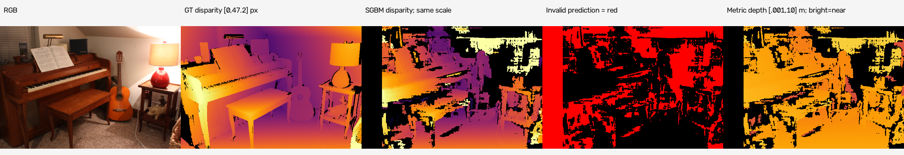
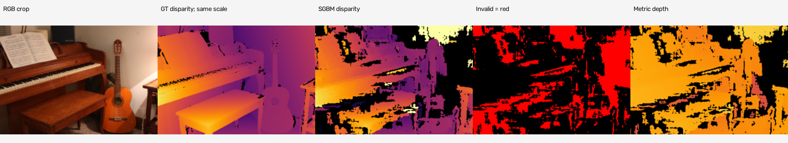
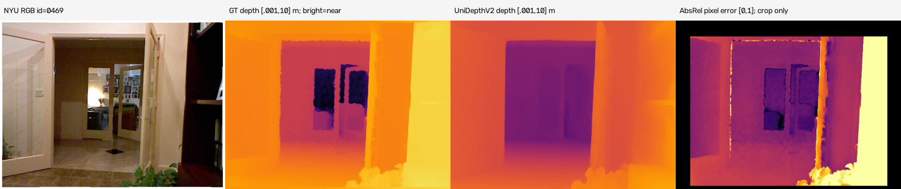
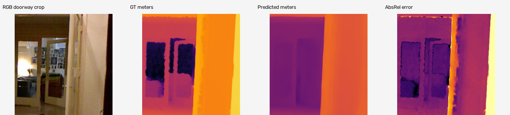
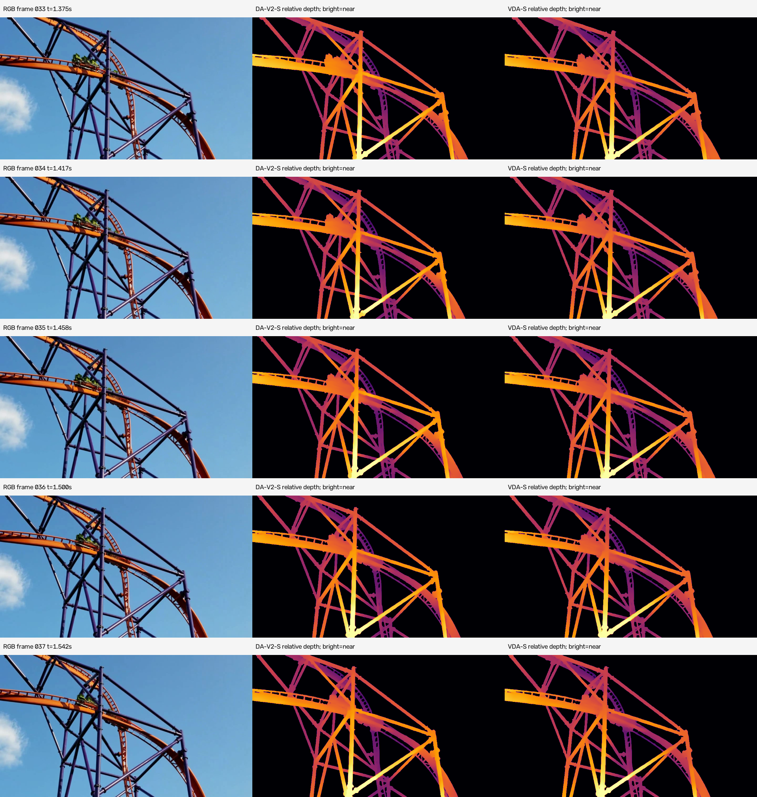
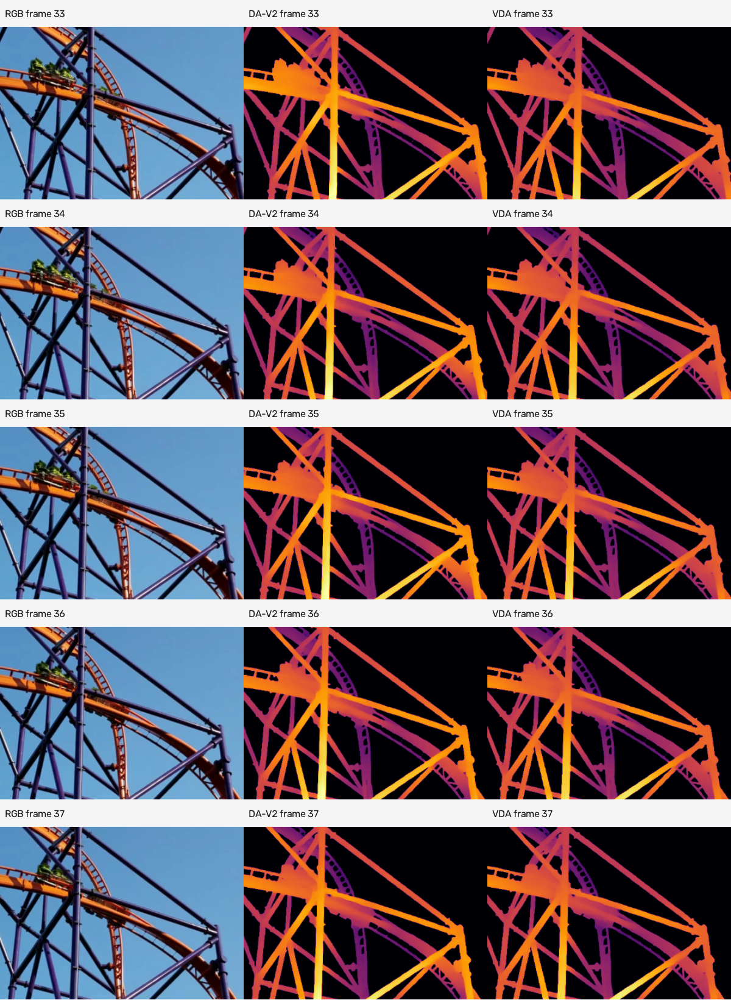

# Part 1 / Part 2：结果解释与课程素材难例

## 正式结果的边界

本次全部使用课程规定素材。NYU 是654张单图无对齐米制评价；指定视频无深度GT，仅用于相对深度和时间表现的定性比较。米制误差、立体视差误差和视频颜色不构成同一排名。

## 立体：MAE与覆盖率必须共同解释

BM像素加权MAE为1.811867 px，覆盖率59.9567%；SGBM为1.955948 px，覆盖率75.9570%。SGBM覆盖率高约16.00个百分点，但有效预测集合不同，不能据较低BM的MAE直接断言BM整体更好。逐场景结果完整保留，参数未按测试GT优化。深度换算已包含doffs、baseline毫米转米和OpenCV视差除16。

### 难例1：Middlebury PianoL

本例按SGBM逐场景MAE最大选择，MAE为6.810662 px。钢琴、琴键、谱架及明亮墙面包含重复纹理、细结构和弱纹理区域；预测有成片无效区域和错误对应，红色掩码与GT对照清楚显示这一点。局部图展示钢琴与背景边界。MAE只计预测有效区域，必须同时查看该场景coverage，不能把黑色无效区当成正确远深度。

## NYU：绝对尺度与空间结构分别观察

UniDepthV2全部654张、逐图等权结果：AbsRel=0.129425440，RMSE=0.423728870 m，δ1=0.875653308。这里是课程协议自有运行结果，不声称复现论文官方分数。历史Depth Pro记录不属于本次运行，也未用于选择UniDepth设置。

### 难例2：NYU 0469，门框与远处房间

本例是本次654张中AbsRel最大的样本（0.674519414）。门洞、狭长纵深及玻璃／反射外观增加了场景解释的难度；预测保留主要门框轮廓，但远处细结构被平滑。评价域内预测／GT的中位比约1.450，表明此例存在明显尺度高估；误差图也显示门框、近处边界和植物附近的大误差。所有米制面板使用同一0.001–10 m显示范围，未为本例拟合尺度。

## 视频：共同结构与残留伪影

重新下载官方链接仍得到70帧、24 fps；全部70帧参与两模型推理和三份原速视频，时长约2.917秒。帧数不足100的事实写入source.json，不用循环、插帧或改变帧率制造更多原始帧。两方法保留各自整段固定P1/P99范围，亮色为近、暗色为远；颜色不是共享的米制刻度。

### 难例3：过山车细杆交叉及运动，帧33–37

两方法均恢复近处轨道与支架、远处天空的基本层次；细杆交叉、移动座舱及边界仍是困难部位。连续帧与局部图展示支架厚度和边缘形状的变化；VDA与逐帧DA结果整体接近，没有依据把短片上的视觉差别写成全面精度提升或“消除闪烁”。部分天空／树冠区域被固定显示范围压到暗端，黑色不能解释为无穷远或有效性掩码。无GT时不对这些位置作米制误差判断。

## 效率测量

使用同一台本机GPU、独立进程。计时包含预处理、推理、输出恢复与CPU传输，排除加载与磁盘输出。UniDepth的计时样本是32张官方开发图；DA／VDA使用正式片段。均预热后测3轮，VDA整片时间除实际帧数。FP32米制模型与FP16相对模型的精度、内部输入尺寸、窗口算法不同，时间差不能单独归因为某一架构模块。

| 模型 | ms/frame均值 ± std | 峰值allocated MiB | 实际网络输入 |
| --- | --- | --- | --- |
| unidepthv2 | 30.351 ± 0.004 | 583.5 | [[1, 3, 658, 868]] |
| da2 | 19.158 ± 0.038 | 339.3 | [[1, 3, 518, 924]] |
| vda | 26.178 ± 0.105 | 2632.3 | [[1, 32, 3, 518, 924]] |

全部逐轮记录见efficiency/。立体CPU时间含左右匹配，不与GPU推理表混排。
